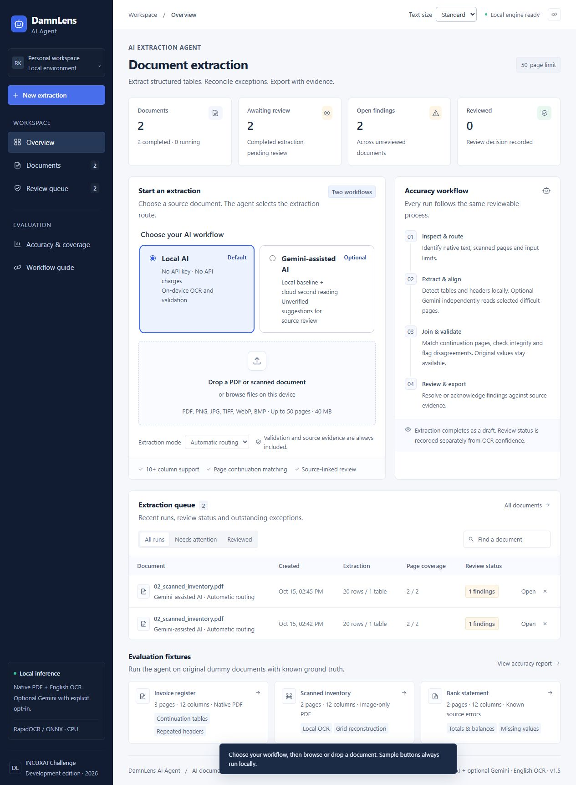
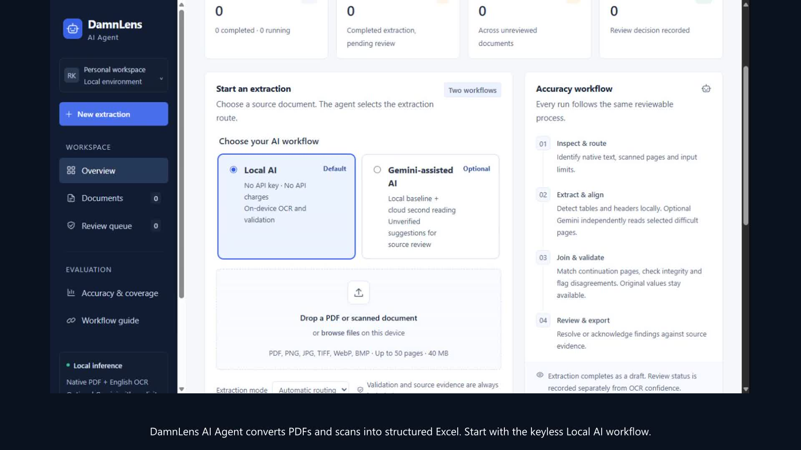
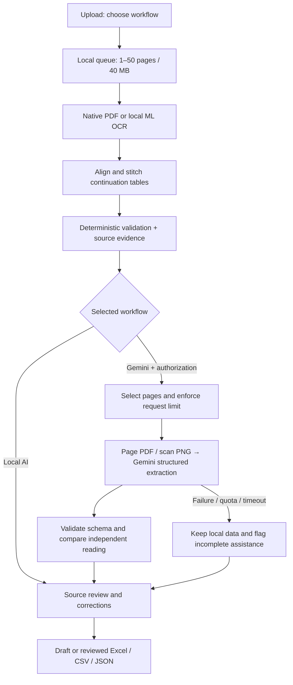

# DamnLens AI Agent

**Two AI workflows. One source-verified spreadsheet.** A document-to-Excel agent for the INCUXAI AI Agent Development Challenge 2026: keyless local AI, plus optional Gemini assistance for difficult pages.

DamnLens AI Agent reads digital PDFs and scanned documents, reconstructs tables, joins continuation pages, detects data problems and exports traceable Excel workbooks. The operational workspace shows the extraction queue, agent stages, page coverage and validation findings. Inspect original pages beside the extracted data, record corrections and complete a snapshot-bound review before labelling an export as reviewed.



## Judges: setup and launch

Requires **64-bit Python 3.12**, 4 GB RAM minimum (8 GB recommended), and network access for initial dependency installation. A CPU is sufficient. Default **Local AI** needs no API key, GPU, Tesseract installation, subscription or runtime model download. English OCR models are included in `models/`. Optional Gemini needs your own key and internet connection.

```bash
git clone https://github.com/rayanakarthikeyan/damnlens-ai-agent.git
cd damnlens-ai-agent
```

**Windows:** extract the complete repository ZIP and double-click **START_DAMNLENS.cmd**. Keep the console open while testing. It checks the bundled model, creates a local environment if needed, installs pinned dependencies once, then opens the workspace. No PowerShell policy change is needed.

Windows command line:

```powershell
.\START_DAMNLENS.cmd
```

macOS / Linux:

```bash
sh start.sh
```

The launcher prints and opens the local URL. It starts at **http://127.0.0.1:8765**, choosing the next free port if necessary. The browser opens after server readiness. Press Ctrl+C to stop. Subsequent launches work offline when all dependencies are present.

**One-command judge checks:** `START_DAMNLENS.cmd --judge-test --offline` (Windows) or `sh start.sh --judge-test --offline` (macOS/Linux), after initial setup. Eight checks cover all three PDF/Excel pairs against exact truth, nested line items, cross-page source parts, duplicate records through 50 pages, 51-page rejection and checkpoint recovery. Failure returns a nonzero exit code; results go to `reports/judge-check-latest.json`. No development libraries are required.

**Diagnostics only:** `START_DAMNLENS.cmd --check --offline`, or `python setup_judges.py --check`. **Install without launching:** `python setup_judges.py --setup-only`. Add `--no-browser` or `--port 8786` to the launcher as needed. The UI's **Text size → Large** setting increases all text by 12.5% and persists on this browser. Standard mode uses 13px minimum secondary labels, 14px data cells and 15px explanatory text with stronger contrast; normal browser zoom also works.

If script execution is restricted on Windows, use the manual commands below rather than changing your system policy. On Linux, OpenCV may require `sudo apt-get install libgl1 libglib2.0-0`; Python virtual environments may require the `python3-venv` package. macOS dependencies are supplied as Python wheels on supported systems. Windows is locally verified; Windows, Ubuntu and macOS are covered by passing CI tests, fresh setup and offline judge checks.

### Manual setup

```bash
python -m venv .venv
# Windows:
.venv\Scripts\python -m pip install -r requirements.txt
.venv\Scripts\python run.py
# macOS / Linux:
.venv/bin/python -m pip install -r requirements.txt
.venv/bin/python run.py
```

Use `python run.py --no-browser --port 8766` inside the activated environment to change the port or skip opening a browser. Initial OCR initialization can take several seconds. Large scanned documents take longer; page progress remains visible. Only one extraction runs at a time to keep model memory bounded.

### Headless judging

```bash
python convert.py samples/01_invoice_register.pdf -o result.xlsx --json
python convert.py scan.png -o scan.xlsx --force-ocr
```

Exit code 0 means conversion completed, 1 means a fatal error and 2 means no tables were extracted. Findings do not make the CLI fail: source errors are preserved in the output and listed on the Validation sheet. Check that sheet before using the data.

### Docker alternative

```bash
docker build -t damnlens-ai-agent .
docker run --rm -p 127.0.0.1:8765:8765 -v damnlens-data:/data damnlens-ai-agent
```

The image is verified in CI as a non-root service: all three sample documents are converted through its API with exact cells/headers and valid Excel. `.env` files are excluded from the build. For optional Gemini, pass your configuration at runtime with `--env-file .env`; no cloud key is needed for Local AI. See the [container evidence](reports/container-check.json).

## What the agent does

1. **Inspect:** validate the file and the 1–50 page limit; inspect each page for usable native text.
2. **Extract:** detect ruled native tables with PyMuPDF. For borderless text, group headers and anchor columns to their positions. Retry with OCR when native extraction fails or produces no tables.
3. **Recognize:** rasterize scans at 220 DPI, recover right-angle scan orientation, deskew modest scan angles, recognize text locally using RapidOCR with the English PP-OCRv3 model, reconstruct grid cells using OpenCV, and anchor borderless values to detected headers. Empty grid cells with visible ink get a local OCR retry. PDF rotation is normalized for extraction while evidence stays aligned with the original page. A sparse group heading above real column labels is handled separately.
4. **Stitch:** match eligible table streams on adjacent pages using conservative header and horizontal-span checks. Two different tables can each continue across the same pair of pages. Headerless continuation requires matching column counts and horizontal spans. Repeated page headers are removed. Identical business rows are preserved and flagged, never silently deduplicated.
5. **Validate:** check totals/subtotals, quantity × unit price, net + tax, running bank balances, numeric type inconsistencies, empty columns, missing values, sparse rows, duplicate rows, low OCR scores and pages with no detected table. Financial checks use decimal arithmetic and a half-cent rounding tolerance; large totals do not get a looser relative tolerance. Borderless alignment gets an explicit review finding.
6. **Review and export:** preserve row evidence, record corrections, rerun validation and maintain a separate human review state. Export Excel, JSON or CSV. Draft exports remain labelled unreviewed; completing review records the exact data fingerprint and any acknowledged findings. A correction invalidates the review and retains its prior decision in history.

This is a bounded inspect → extract → retry → stitch → validate → review workflow. Local AI uses pretrained ML recognition and deterministic layout/validation. Gemini-assisted AI adds an independent multimodal LLM reading; it never silently replaces local values. No OCR or language model is trained by this project.

## Choose your workflow

| | Local AI — default | Gemini-assisted AI — optional |
|---|---|---|
| Processing | Native PDF + local ML OCR → stitch → validate | Same local baseline → select difficult pages → Gemini second reading → compare |
| Cost | No API key, per-page API charges or provider quota | Google's free/paid tier, availability and quotas apply; may incur charges |
| Connectivity | Offline after dependencies are installed | Internet and server-side `GEMINI_API_KEY` required |
| Documents | Stay on this device | Selected full pages sent to Google after explicit authorization |
| Integrity | Geometry, source evidence, decimal checks, review findings | Same controls, plus independent candidate tables and conservative discrepancy mapping |
| Recovery | Native/OCR fallback, verified checkpoints | Local result retained; failed/unknown calls never automatically resent |

Local is free of API charges, with hardware, storage and the **50-page / 40 MB** web limit still applying. Gemini offers limited free access to eligible models and paid usage; check [pricing](https://ai.google.dev/gemini-api/docs/pricing), [quotas](https://ai.google.dev/gemini-api/docs/rate-limits) and [data terms](https://ai.google.dev/gemini-api/terms). No bundled API credits or free-tier entitlement are assumed.

### Optional Gemini setup

1. Obtain your own key from [Google AI Studio](https://aistudio.google.com/apikey). Copy `.env.example` to `.env` in the project folder and set `GEMINI_API_KEY`; alternatively set it in the launch environment. `.env` is ignored by Git. Never commit or share a key.
2. Restart DamnLens. Select **Gemini-assisted AI**, **Difficult pages first** (default) or **Every page, within limit**, a request limit (default 3, maximum 50), and cloud authorization.
3. Upload a dummy/public document. Every page first receives local extraction. Difficult-page selection includes scans, uncovered pages, validation findings and inferred/hierarchical headers. No qualifying pages means zero API requests. The heuristic can miss clean-looking extraction errors; all-pages mode offers broader checking.
4. Open **AI workflow** on the result. Inspect coverage, token usage, separate candidate tables, structural disagreements and mapped cell proposals. **Inspect & edit** opens source-linked correction; saving preserves the original, reruns validation and resets review. Sample buttons always run locally.

`GEMINI_MODEL` defaults to `gemini-3.8-flash`, documented as a stable PDF/structured-output model at integration time; use a compatible model available to your account. Availability can change. The HTTPS `generateContent` integration sends a one-page PDF for native pages or a 180-DPI PNG for OCR-routed pages, requesting structured JSON. No SDK dependency, model tools or URL retrieval. Documents, including embedded prompts, are data.

```bash
python convert.py samples/01_invoice_register.pdf -o assisted.xlsx --json --workflow gemini --allow-cloud --gemini-scope all --max-requests 3
```

Each request allows at most 8,192 output tokens and a 60-second socket timeout. Web jobs persist a reservation before sending; the CLI saves a `.gemini-ledger.json` beside its output (override with `--gemini-ledger`). Reusing a ledger never grants a fresh budget. Failures stop cloud processing; no automatic retries. Resume reuses completed readings, counts unknown/failed attempts and never resends them. A changed baseline needs a new opted-in extraction with a new ledger. **Retry OCR** explicitly runs locally. The request limit is **not a currency cap**: failed requests may incur unreported charges. Provider token counts are not a billing invoice. Run one process per ledger.

**Verification:** live Gemini readings matched **360/360 data cells and all 36 headers across three original dummy first pages** (native invoice, rendered scan and bank statement). Two earlier scan-PDF requests returned HTTP 503; both failures are preserved and local output remained exact. These are small development checks, not hidden/general accuracy or an uplift measurement. See [live Gemini results](reports/GEMINI_EVALUATION.md), the local cohorts below and [architecture/requirement mapping](docs/WORKFLOWS.md).

## Review workspace

- Professional operational UI: live run queue, real counts, search/status filters, cross-document review inbox, agent stages, page coverage, timestamped execution log and sample fixtures.
- Digital PDF, PDF scans, PNG, JPEG, TIFF, BMP and WebP input; up to **50 pages / 40 MB** per web upload. Multi-frame TIFF behavior depends on PyMuPDF; use PDF for multi-page scans.
- Side-by-side original page, highlighted row evidence, table navigation and Excel export.
- Validation findings link directly to the corresponding row.
- Double-click a cell or focus it and press Enter to edit. The original value remains in the correction history.
- Retry with forced OCR for PDFs with broken text layers. Before reprocessing, a retry archives the prior run including corrections and review history. Download any previous run as Excel or JSON from the agent run log. Exports are blocked while a replacement run is pending, preventing stale data downloads.
- Source zoom, page navigation, flagged-row filtering, severity filters and correction history support source verification.
- Completing review requires a source-check confirmation. Outstanding findings also require explicit acknowledgement and a note. This is a human decision, not a measured accuracy guarantee.
- Source data stays under `.jobs/`, which is ignored by Git. The delete control permanently removes the selected local job. Do not delete a job whose source is your only copy.

## Submission deliverables

| Required deliverable | Where to find it |
|---|---|
| Working AI agent | [Application entry point](run.py) · [CLI converter](convert.py) |
| Complete source code | [Python backend](app/) · [Browser UI](web/) · [Download source ZIP](https://github.com/rayanakarthikeyan/damnlens-ai-agent/archive/refs/heads/main.zip) |
| Setup and run instructions | [Judge quick start](JUDGE_START_HERE.txt) · [Detailed setup](#judges-setup-and-launch) |
| At least three sample PDFs with Excel outputs | [Matched PDF → Excel files](#sample-pdfs-and-excel-outputs) below |
| Accuracy and validation report | [Sample accuracy and findings](reports/ACCURACY_REPORT.md) · [Complex/public evaluation and limits](reports/JUDGE_EVALUATION.md) |
| Demo video, 2–5 minutes | [Watch the demo — 3 minutes 49 seconds](docs/damnlens-demo.mp4) |

[](docs/damnlens-demo.mp4)

The 1080p video records operating the working application: PDF extraction, scanned OCR, source inspection, complex tables, validation, correction, review and an actual Excel download. Captions are burned in, with no audio or added scoring labels. Idle gaps between steps are removed; extraction footage plays at captured speed. Gemini configuration is demonstrated without a new cloud request. [Chapter guide](docs/DEMO_SCRIPT.md) · [Optional subtitles](docs/recordings/damnlens-demo.srt) · [Video verification](reports/demo-verification.json).

[Requirement checklist](docs/SUBMISSION_CHECKLIST.md) · [Library and AI-assistance credits](THIRD_PARTY_NOTICES.md) · [OCR model credits](models/README.md)

### Sample PDFs and Excel outputs

All three samples contain fictional data and 12-column tables. Each PDF links directly to its corresponding workbook.

| Sample | Input PDF | Converted Excel |
|---|---|---|
| Invoice register — digital, 3 pages | [01_invoice_register.pdf](samples/01_invoice_register.pdf) | [01_invoice_register.xlsx](samples/converted/01_invoice_register.xlsx) |
| Inventory — image-only scan, 2 pages | [02_scanned_inventory.pdf](samples/02_scanned_inventory.pdf) | [02_scanned_inventory.xlsx](samples/converted/02_scanned_inventory.xlsx) |
| Bank statement — validation errors, 2 pages | [03_bank_statement.pdf](samples/03_bank_statement.pdf) | [03_bank_statement.xlsx](samples/converted/03_bank_statement.xlsx) |

The bank sample deliberately contains a wrong total, an altered balance and missing fields. Extraction preserves these source errors; validation flags them.

### Measured results

| Evaluation | Exact cases | Matching data cells |
|---|---:|---:|
| [Submission samples](reports/benchmark.json) | 3/3 | 864/864 |
| [Varied document audit](reports/judge-audit-after.json) | 15/15 | 1,440/1,440 |
| [Complex table audit](reports/complex-evaluation.json) | 16/16 | 962/962 |
| [Public digital PDFs](reports/public-evaluation-final.json) | 3/3 | 261/261 |

The [expanded public evaluation](reports/EXPANDED_EVALUATION.md) adds seven previously unevaluated aggregate/dummy PDFs and four image-only derivatives. Source-frozen checkpoint cases improved from **3/11 to 10/11** after repairs. The remaining case preserves all 376 checked data cells and the correct shape, but has an explicitly flagged `Sl.`/`SI.` header ambiguity. Some cases audit selected source columns or rows, so these checkpoint results are not whole-document cell accuracy.

These cases were used during development; they do not establish hidden-PDF accuracy. Public comparisons use the disclosed anchor/shared-value policy in the [evaluation report](reports/JUDGE_EVALUATION.md). The [automated suite](tests/) also covers a 50-page, 501-row, 12-column table with 49 repeated headers removed. [Windows and Ubuntu CI results](https://github.com/rayanakarthikeyan/damnlens-ai-agent/actions) are available on GitHub.

### Excel output

Each workbook contains **Overview**, one sheet per joined **Table**, **Validation**, **Evidence**, **Corrections**, **Page coverage**, and **Run log**. Overview records draft/reviewed status, review time, accepted findings and the review note. Amounts, dates and percentages are typed; identifiers and leading zeros remain text. Source decimal precision is retained. Values exceeding Excel’s 15-digit numeric precision remain text. Tables have filters, frozen headers, readable widths and warning highlights. Row evidence includes the source page and bounding box in PDF points. Source text beginning with `=` is stored as text, never as an executable formula. CSV formula-like values are escaped.

## Reproduce the evaluation

```bash
python -m pip install -r requirements-dev.txt
python scripts/generate_samples.py
python scripts/benchmark.py
python scripts/judge_audit.py
python scripts/complex_evaluation.py
# Optional: download and verify the pinned public PDF fixtures
python scripts/public_evaluation.py --fetch
python scripts/expanded_evaluation.py --fetch
python -m pytest -q --junitxml=reports/tests.xml
```

The benchmark compares cells in original row order and penalizes extra/missing cells. Exact-row precision/recall compares full-row multisets, including duplicate multiplicity. Header equality is checked separately. Source validation mistakes are not extraction mistakes when faithfully preserved. OCR scores are model recognition confidence, not accuracy measurements. Native PDF rows have blank OCR-score cells in Excel; the JSON record retains its internal non-OCR marker.

The expanded evaluator returns a failure code for the remaining strict header mismatch. CI separately uses `--check-review-routing`, which permits only a sole header mismatch with a recorded OCR disagreement; unexpected data, shape or table-count failures still fail. The saved report always retains the strict 10/11 result. See its source-annotation errata and reproduction details in [EXPANDED_EVALUATION.md](reports/EXPANDED_EVALUATION.md).

Tests cover native tables, OCR, borderless multiword headers, page stitching, duplicate preservation, headerless continuations, the 50/51-page boundary, encrypted/corrupt/oversized files, numeric locales, subtotals, line arithmetic, bank errors, typed XLSX, formula injection, evidence, corrections, origin/host protection and restart recovery.

Maintainer checks: install `requirements-dev.txt`, run `npm ci --ignore-scripts`, then `python scripts/check_quality.py`. This checks Python lint/imports/formatting plus JavaScript syntax and frontend formatting. Node.js is needed only for maintenance checks; judges can run the Python app without it. The [quality audit](reports/CODE_QUALITY.md) records 158 passing tests on Windows, Ubuntu and macOS, plus verified Docker extraction/export. See [CONTRIBUTING.md](CONTRIBUTING.md) for module contracts, isolated testing, Docker verification and release checks. Result tabs support **Left/Right, Home and End** with labelled panels and one selected Tab-stop.

## Architecture



`app/workflow.py` orchestrates both paths; `app/gemini.py` handles bounded cloud reading, schema checks, comparison and usage. `app/quality.py` computes observed facts and snapshot-bound review; `app/engine.py` handles local extraction/stitching/validation; `app/exporter.py` handles safe typed export; `app/main.py` owns limits, jobs and persistence. `web/` is plain HTML/CSS/JavaScript without a CDN or build step. API docs: `/api/docs`.

## Accuracy workflow (v1.1)

Extraction and review are separate states. The agent automatically routes pages, extracts tables, matches continuations and validates the result. A human checks source evidence and either resolves or acknowledges findings. A reviewed workbook is tied to a fingerprint of the source, data, findings, coverage and correction history; any subsequent data change resets review. The UI never represents OCR model confidence as measured extraction accuracy.

A review is a local workflow record; there is no authenticated reviewer identity or cryptographic signature. The source hash and review fingerprint are integrity aids.

## Practical limits and recovery

- Bounded multi-line/hierarchical headers, explicit merged spans, a nested line-item layout, rotations and modest skew are covered by development regressions. Arbitrary nested layouts, changing schemas, handwriting and heavily damaged scans may still need manual reconstruction. Printed English is the evaluated OCR target.
- Identical schemas can represent different sections; explicit account/invoice context helps keep them separate. Compatible streams can continue independently. Duplicate business rows are never dropped automatically. Initial description-only continuation fragments can join the prior identified row, retaining both source parts and a review finding; complicated or ambiguous page breaks still require inspection.
- Borderless detection is heuristic; a structured-looking result is not proof of correct column alignment. Pages without a detected table produce a page-level finding rather than disappearing silently. Unrecognized secondary tables on an otherwise extracted page may still require visual review.
- Totals are checked only where recognizable labels and numeric columns exist. Quantity, price, net and bank checks require matching headers. Not every business rule is inferable. Section totals sum since the preceding total; an explicitly labelled grand total sums all normal rows. Sparse total rows may themselves receive a sparse-row warning.
- The queue is single-process and persists source/status/results and completed-page checkpoints. On restart, unfinished jobs become interrupted. Resume reuses only pages verified against source, code, OCR mode/assets and library signatures; corrupt or mismatched checkpoints are recomputed. An interrupted current page restarts. There is no mid-page continuation, cross-process locking, cancellation, authentication or hosted multi-user service.
- Jobs contain source copies and results until deleted. Local AI makes no cloud document requests. Opted-in Gemini sends selected full pages to Google under its API terms. Keys remain server-side in the launch environment or ignored `.env`, excluded from jobs, exports, logs and browser storage. The app binds to localhost and restricts host/origin; it is a local judging application.

### Setup troubleshooting

- **Python missing:** install 64-bit Python 3.12 from [python.org](https://www.python.org/downloads/), enable the Python launcher/PATH option, reopen the folder and start again. The setup script does not install system software.
- **Cannot download packages:** initial setup needs internet access to PyPI. Retry the launcher after restoring the connection. An incomplete installation is detected and retried; `--offline` refuses installation explicitly.
- **Linux OpenCV import error:** install `libgl1` and `libglib2.0-0`; `python3-venv` may also be required. Then rerun setup.
- **Damaged OCR asset:** download the complete ZIP or clone again. Diagnostics verify model/dictionary SHA-256 hashes before launching.
- **Port busy:** automatic launch tries ports 8765–8784; choose `--port 8786` if all are occupied. An explicitly requested occupied port produces an actionable error.
- **Recover after interruption:** restart and open the interrupted document. **Resume extraction** reuses verified completed pages using the original routing mode. **Retry OCR** starts a fresh OCR run. The original stays local, existing results are archived and export is unavailable during processing.

`DAMNLENS_DATA` selects an alternate job folder. The legacy `LEDGERLENS_DATA` variable remains a fallback for existing installations.

## Authorship and licensing

A project by **[Rayan Karthikeyan](https://github.com/rayanakarthikeyan)** for the INCUXAI AI Agent Development Challenge 2026.

Licensed under [AGPL-3.0-or-later](LICENSE). Third-party libraries and model weights retain their respective licenses. Development acknowledgments and dependency credits are listed in [THIRD_PARTY_NOTICES.md](THIRD_PARTY_NOTICES.md).
