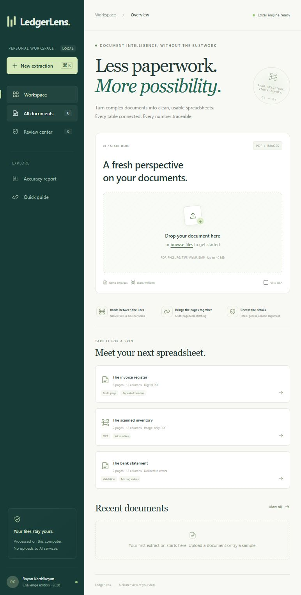

# LedgerLens

**AI document extraction with source evidence and explicit review.** A local document-to-Excel agent for the INCUXAI AI Agent Development Challenge 2026.

LedgerLens reads digital PDFs and scanned documents, reconstructs tables, joins continuation pages, detects data problems and exports traceable Excel workbooks. The operational workspace shows the extraction queue, agent stages, page coverage and validation findings. Inspect original pages beside the extracted data, record corrections and complete a snapshot-bound review before labelling an export as reviewed.



## Run in three commands

Requires **64-bit Python 3.12**, 4 GB RAM minimum (8 GB recommended), and network access for the initial Python dependency installation. A CPU is sufficient. No API key, GPU, Tesseract installation, subscription or model download is needed at runtime. The English model is included in `models/`.

```bash
git clone https://github.com/rayanakarthikeyan/ledgerlens.git
cd ledgerlens
```

Windows PowerShell:

```powershell
.\start.ps1
```

macOS / Linux:

```bash
sh start.sh
```

Open **http://127.0.0.1:8765**. The launcher opens it automatically. Press Ctrl+C to stop.

If script execution is restricted on Windows, use the manual commands below rather than changing your system policy. On Linux, OpenCV may require `sudo apt-get install libgl1 libglib2.0-0`; Python virtual environments may require the `python3-venv` package. macOS dependencies are supplied as Python wheels on supported systems. Windows is locally verified; Linux is covered by the included CI workflow when GitHub Actions is available.

### Manual setup

```bash
python -m venv .venv
# Windows:
.venv\Scripts\python -m pip install -r requirements.txt
.venv\Scripts\python run.py
# macOS / Linux:
.venv/bin/python -m pip install -r requirements.txt
.venv/bin/python run.py
```

Use `python run.py --no-browser --port 8766` inside the activated environment to change the port or skip opening a browser. Initial OCR initialization can take several seconds. Large scanned documents take longer; page progress remains visible. Only one extraction runs at a time to keep model memory bounded.

### Headless judging

```bash
python convert.py samples/01_invoice_register.pdf -o result.xlsx --json
python convert.py scan.png -o scan.xlsx --force-ocr
```

Exit code 0 means conversion completed, 1 means a fatal error and 2 means no tables were extracted. Findings do not make the CLI fail: source errors are preserved in the output and listed on the Validation sheet. Check that sheet before using the data.

### Docker alternative

```bash
docker build -t ledgerlens .
docker run --rm -p 127.0.0.1:8765:8765 -v ledgerlens-data:/data ledgerlens
```

The container runs as a non-root user. The Dockerfile is supplied for portability; local Windows Python execution is the directly verified setup.

## What the agent does

1. **Inspect:** validate the file and the 1–50 page limit; inspect each page for usable native text.
2. **Extract:** detect ruled native tables with PyMuPDF. For borderless text, group headers and anchor columns to their positions. Retry with OCR when native extraction fails or produces no tables.
3. **Recognize:** rasterize scans at 220 DPI, deskew modest scan angles, recognize text locally using RapidOCR with the English PP-OCRv3 model, reconstruct grid cells using OpenCV, and infer aligned columns when no grid exists.
4. **Stitch:** match eligible table streams on adjacent pages using conservative header and horizontal-span checks. Two different tables can each continue across the same pair of pages. Headerless continuation requires matching column counts and horizontal spans. Repeated page headers are removed. Identical business rows are preserved and flagged, never silently deduplicated.
5. **Validate:** check totals/subtotals, quantity × unit price, net + tax, running bank balances, numeric type inconsistencies, empty columns, missing values, sparse rows, duplicate rows, low OCR scores and pages with no detected table. Borderless alignment gets an explicit review finding.
6. **Review and export:** preserve row evidence, record corrections, rerun validation and maintain a separate human review state. Export Excel, JSON or CSV. Draft exports remain labelled unreviewed; completing review records the exact data fingerprint and any acknowledged findings. A correction invalidates the review and retains its prior decision in history.

This is a bounded agent workflow with an explicit inspect → extract → retry → stitch → validate → review lifecycle. It uses pretrained ML for recognition and deterministic layout/validation logic. It does not call an LLM or claim to train an OCR model.

## Review workspace

- Professional operational UI: live run queue, real counts, search/status filters, cross-document review inbox, agent stages, page coverage, timestamped execution log and sample fixtures.
- Digital PDF, PDF scans, PNG, JPEG, TIFF, BMP and WebP input; up to **50 pages / 40 MB** per web upload. Multi-frame TIFF behavior depends on PyMuPDF; use PDF for multi-page scans.
- Side-by-side original page, highlighted row evidence, table navigation and Excel export.
- Validation findings link directly to the corresponding row.
- Double-click a cell or focus it and press Enter to edit. The original value remains in the correction history.
- Retry with forced OCR for PDFs with broken text layers. Before reprocessing, a retry archives the prior run including corrections and review history. Download any previous run as Excel or JSON from the agent run log. Exports are blocked while a replacement run is pending, preventing stale data downloads.
- Source zoom, page navigation, flagged-row filtering, severity filters and correction history support source verification.
- Completing review requires a source-check confirmation. Outstanding findings also require explicit acknowledgement and a note. This is a human decision, not a measured accuracy guarantee.
- Source data stays under `.jobs/`, which is ignored by Git. The delete control permanently removes the selected local job. Do not delete a job whose source is your only copy.

## Deliverables and measured results

| Deliverable | Location |
|---|---|
| Working application and source | `app/`, `web/`, `run.py`, `convert.py` |
| Setup and run instructions | This README; `start.ps1`, `start.sh`, `Dockerfile` |
| Three original sample PDFs | `samples/01_invoice_register.pdf`, `02_scanned_inventory.pdf`, `03_bank_statement.pdf` |
| Corresponding Excel workbooks | `samples/converted/` |
| Accuracy and validation report | [reports/ACCURACY_REPORT.md](reports/ACCURACY_REPORT.md) |
| Cell-level benchmark output | `reports/benchmark.json`, `reports/01_*.json`, `reports/02_*.json`, `reports/03_*.json` |
| Ground truth and regeneration | `samples/ground_truth.json`, `scripts/generate_samples.py` |
| Automated tests | `tests/`, `reports/tests.xml`, `.github/workflows/test.yml` |
| Short demo | `docs/ledgerlens-demo.mp4`, `docs/DEMO_SCRIPT.md` |
| Requirement mapping | [docs/SUBMISSION_CHECKLIST.md](docs/SUBMISSION_CHECKLIST.md) |
| Library/model credits | [THIRD_PARTY_NOTICES.md](THIRD_PARTY_NOTICES.md), `models/README.md` |

On the three included English synthetic fixtures, **864 / 864 data cells** and all headers match ground truth. The scanned fixture is image-only: 240 / 240 cells match. A separate automated 50-page test checks 501 rows × 12 columns and 49 removed repeated headers. These results describe this development set, not expected accuracy on arbitrary or hidden PDFs. Timings and raw comparisons are included in the report.

The bank fixture deliberately contains a wrong debit total, an altered running balance, a missing debit and missing currency. Faithful extraction preserves these errors; validation flags them. A changed balance can produce two transition warnings because it affects both the row's incoming and outgoing balance checks.

### Excel output

Each workbook contains **Overview**, one sheet per joined **Table**, **Validation**, **Evidence**, **Corrections**, **Page coverage**, and **Run log**. Overview records draft/reviewed status, review time, accepted findings and the review note. Amounts, dates and percentages are typed; identifiers and leading zeros remain text. Source decimal precision is retained. Values exceeding Excel’s 15-digit numeric precision remain text. Tables have filters, frozen headers, readable widths and warning highlights. Row evidence includes the source page and bounding box in PDF points. Source text beginning with `=` is stored as text, never as an executable formula. CSV formula-like values are escaped.

The v1.1 regression suite contains **52 tests**, including same-schema table-position matching, real multi-table PDFs, snapshot-bound review, prior-run recovery and precision-preserving exports.

## Reproduce the evaluation

```bash
python -m pip install -r requirements-dev.txt
python scripts/generate_samples.py
python scripts/benchmark.py
python -m pytest -q --junitxml=reports/tests.xml
```

The benchmark compares cells in original row order and penalizes extra/missing cells. Exact-row precision/recall compares full-row multisets, including duplicate multiplicity. Header equality is checked separately. Source validation mistakes are not extraction mistakes when faithfully preserved. OCR scores are model recognition confidence, not accuracy measurements.

Tests cover native tables, OCR, borderless multiword headers, page stitching, duplicate preservation, headerless continuations, the 50/51-page boundary, encrypted/corrupt/oversized files, numeric locales, subtotals, line arithmetic, bank errors, typed XLSX, formula injection, evidence, corrections, origin/host protection and restart recovery.

## Architecture

```text
Browser review UI ── FastAPI local API ── persistent job queue (single worker)
                                           │
                       inspect → native extraction → OCR fallback
                                           │
                         table fragments → schema stitching
                                           │
                      validation + row evidence + corrections
                                           │
                                  XLSX / CSV / JSON
```

`app/quality.py` computes observed quality facts and snapshot-bound human review; `app/engine.py` contains extraction, layout, stitching and checks; `app/exporter.py` contains typed/safe export; `app/main.py` owns file limits, jobs, persistence and API routes. `web/` is plain HTML/CSS/JavaScript, served locally with no CDN or frontend build step. API documentation is at `/api/docs`.

## Accuracy workflow (v1.1)

Extraction and review are separate states. The agent automatically routes pages, extracts tables, matches continuations and validates the result. A human checks source evidence and either resolves or acknowledges findings. A reviewed workbook is tied to a fingerprint of the source, data, findings, coverage and correction history; any subsequent data change resets review. The UI never represents OCR model confidence as measured extraction accuracy.

A review is a local workflow record; there is no authenticated reviewer identity or cryptographic signature. The source hash and review fingerprint are integrity aids.

## Practical limits and recovery

- Complex nested/merged cells, inconsistent schemas, multiple related tables on a single page, handwriting, heavily damaged scans and arbitrary page rotations may require manual review. Predominantly English printed documents are the supported OCR target.
- Identical schemas on consecutive pages can represent different business sections; verify the joined table. Similar wide tables with different identity columns are kept separate. Multiple compatible table streams can continue independently across consecutive pages. Repeated data rows are never dropped automatically. Split logical rows with complicated page breaks may need manual reconstruction.
- Borderless detection is heuristic; a structured-looking result is not proof of correct column alignment. Pages without a detected table produce a page-level finding rather than disappearing silently. Unrecognized secondary tables on an otherwise extracted page may still require visual review.
- Totals are checked only where recognizable labels and numeric columns exist. Quantity, price, net and bank checks require matching headers. Not every business rule is inferable. Section totals sum since the preceding total; an explicitly labelled grand total sums all normal rows. Sparse total rows may themselves receive a sparse-row warning.
- The queue is single-process and persists source/status/results on disk. On restart, unfinished jobs become interrupted and can be retried from the original. There is no checkpointed mid-page continuation, cross-process locking, cancellation, authentication or hosted multi-user service.
- Jobs contain local source copies and extracted data until deleted. The app binds to localhost, restricts host/origin, uses generated job paths and does not send documents to cloud services. It is a local judging app, not an internet deployment configuration.

## Authorship and licensing

Created for **Rayan Karthikeyan**. Repository commits use **rayanakarthikeyan@gmail.com** as author and committer email. Coding assistance and all upstream libraries/models are credited in `THIRD_PARTY_NOTICES.md`; do not describe AI-assisted code as wholly unaided work. The application uses AGPL-3.0-or-later, with separately licensed upstream dependencies and model weights.

Competition deadline supplied in the brief: **16 October 2026, 7:00 PM**. The brief does not specify a timezone. The submission URL and organizer contact are placeholders; obtain the actual submission link and confirm the deadline timezone with the organizer. This repository does not submit to the competition automatically.
